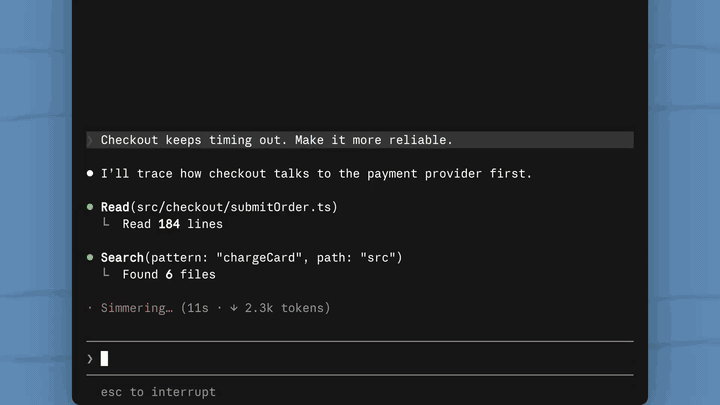

# you-should-know

[](https://video.twimg.com/amplify_video/2106118378331271168/vid/avc1/1920x1080/Mp6xg6xL0ShPQL2A.mp4)

[Original post on X](https://x.com/ClaudeDevs/status/2106118517447876618)

`you-should-know`: a clone of Claude Code's built-in "You should know" observer mod (`cc-plugin-you-should-know`, v2.1.292) as an installable mod. It works through any gateway or provider, including non-first-party gateways.

Every 6th main-agent step, a side request (`$.model.fork`: the session's own model, conversation, and credentials, with no tools) runs the official observer prompt verbatim. It usually answers `learn: none`. When it finds one consequential thing you might miss, it shows a short note above the prompt:

- Offer: `1` Learn more · `2` Knew this already · `3` What is this / Return to topic · `4` Disable (press again to disable) · `0` Dismiss
- Explanation: `1` Understood · `2` Chat in main session · `0` Dismiss
- Asked after dismissing an offer (clears after 20 s): `1` That was helpful · `2` Not relevant · `3` Couldn't understand · `4` Turn off suggestions · `0` Dismiss
- Asked after dismissing an explanation: `1` That was helpful · `2` Didn't understand · `0` Dismiss

Topics you have seen or understood are remembered so they don't repeat. Checks back off when notes are ignored. `CLAUDE_CODE_YOU_SHOULD_KNOW_DEBUG=1` shows check rows.

## Install

```bash
claude --plugin-dir ./plugins/you-should-know
# or
/plugin marketplace add yafyx/you-should-know
/plugin install you-should-know@you-should-know
```

Turn off the built-in version if it’s enabled:

```text
/plugin disable cc-plugin-you-should-know@builtin
```

## Acknowledgments

- Original mod by Anthropic (Claude Code). Demo: [@ClaudeDevs](https://x.com/ClaudeDevs).
- Observer prompt and logic are from the v2.1.292 dump by [wassname](https://github.com/wassname/cc-plugin-you-should-know).
- `hooks/register.js` is generated from the official dump by `tools/build.mjs`, which strips telemetry, removes the first-party availability gate, and tree-shakes the bundle.
